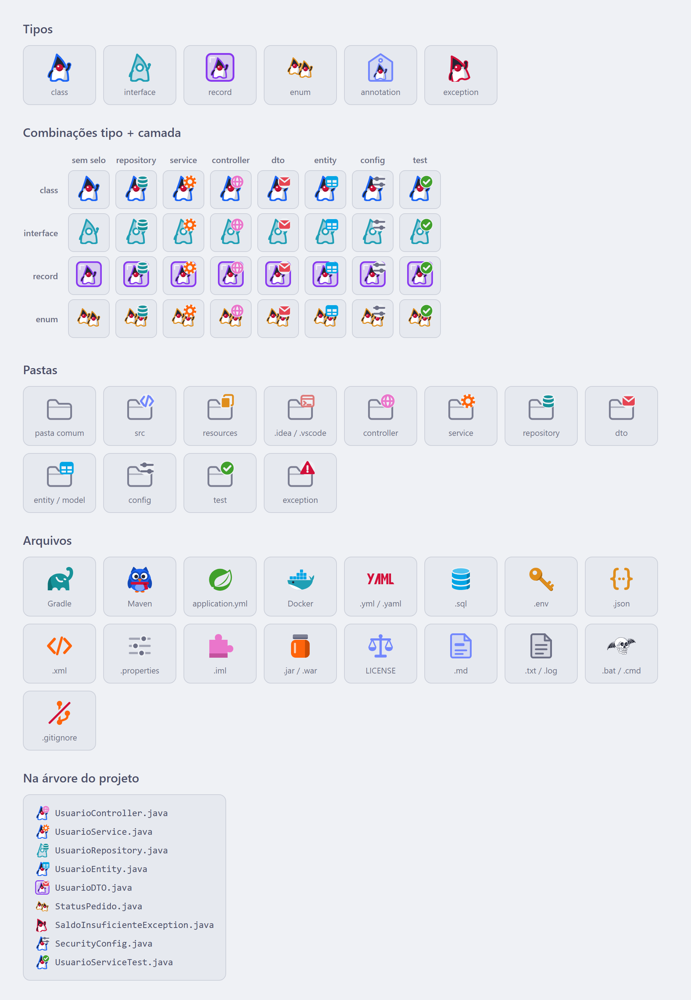

# Layer Icons

Plugin de ícones para o IntelliJ IDEA, pensado para projetos Java e Spring, no estilo da paleta [Catppuccin](https://catppuccin.com).

Cada classe ganha um mascote que mostra **o que ela é** (class, interface, record, enum, anotação ou exception) segurando um selo que mostra **qual camada ela representa** (repository, service, controller, DTO, entity, config ou test). Pastas e arquivos comuns de projeto também ganham ícones próprios.

## No IntelliJ

<!-- Salve o print do IntelliJ em docs/images/intellij.png -->


## Galeria

<picture>
  <source media="(prefers-color-scheme: dark)" srcset="docs/images/gallery-dark.png">
  
</picture>

## Como os ícones são escolhidos

### Classes Java

O ícone de uma classe é montado em duas camadas:

1. **Base (o mascote)**: vem da declaração da classe, lida pela PSI do IntelliJ.
2. **Selo (na mão do mascote)**: vem do sufixo do nome da classe.

| Base | Quando aparece |
|---|---|
| Duke azul | `class` |
| Duke em contorno | `interface` |
| Duke no cubo de gelo | `record` (imutável) |
| Dois Dukes | `enum` (conjunto fixo de valores) |
| Duke na etiqueta | anotação (`@interface`) |
| Duke caindo | qualquer classe que herda de `Throwable`, mesmo que indiretamente |

| Selo | Sufixo do nome |
|---|---|
| Banco de dados | `Repository` |
| Engrenagem | `Service` |
| Globo | `Controller` |
| Envelope | `Dto`, `DTO` |
| Tabela | `Entity`, `Model` |
| Controles | `Config`, `Configuration` |
| Check | `Test` |

Exemplos: `UsuarioRepository` (interface) vira o Duke em contorno segurando o banco de dados; `UsuarioDTO` (record) vira o Duke no cubo de gelo segurando o envelope.

### Pastas

Pastas usam um ícone vazado e recebem um selo quando o nome bate exatamente com uma das camadas (sem diferenciar maiúsculas e minúsculas): `src`, `resources`, `.idea`, `.vscode`, `controller`, `service`, `repository`, `dto`, `entity`, `model`, `config`, `test`, `exception` e `exceptions`.

### Arquivos

As regras são testadas nesta ordem, da mais específica para a mais geral:

1. **Nome exato**
2. **Prefixo** (configurações do Spring e arquivos `.env`)
3. **Extensão**

| Ícone | Arquivos |
|---|---|
| Elefante | `build.gradle(.kts)`, `settings.gradle(.kts)`, `gradle.properties`, `gradle-wrapper.properties`, `gradlew`, `gradlew.bat` |
| Coruja | `pom.xml`, `mvnw`, `mvnw.cmd`, `maven-wrapper.properties` |
| Folha do Spring | `application*` e `bootstrap*` com extensão `.properties`, `.yml` ou `.yaml` |
| Baleia | `Dockerfile`, `.dockerignore`, `docker-compose.yml`, `compose.yml` e `.dockerfile` |
| Chave | `.env` e `.env.*` |
| Balança | `LICENSE`, `LICENSE.md`, `LICENSE.txt` |
| Git riscado | `.gitignore` |
| YAML | `.yml`, `.yaml` |
| Cilindro | `.sql` |
| `{ }` | `.json` |
| `</>` | `.xml` |
| Controles | `.properties` |
| Quebra-cabeça | `.iml` |
| Pote | `.jar`, `.war` |
| Folha com título | `.md`, `.markdown` |
| Folha simples | `.txt`, `.log` |
| Caveira com asas | `.bat`, `.cmd` |

Por causa dessa ordem, `docker-compose.yml` fica com a baleia, `application.yml` fica com a folha do Spring e qualquer outro `.yml` fica com o ícone do YAML.

Todos os ícones têm versão para tema claro e escuro.

## Download

[](https://github.com/EricLps/layer-icons/releases/latest)

Baixe o arquivo `.zip` da última versão e instale pelo IntelliJ em
**Settings → Plugins → ⚙ → Install Plugin from Disk...**

## Instalação

1. No IntelliJ, abra **Settings → Plugins → ⚙ → Install Plugin from Disk...** e escolha o arquivo `.zip` gerado em `build/distributions/`.
2. Reinicie o IntelliJ.

Se outro plugin de ícones estiver ativo, os dois podem disputar os mesmos arquivos. Nesse caso, desative os ícones do outro plugin.

## Desenvolvimento

Requisitos: JDK 21.

Para abrir um IntelliJ de teste com o plugin instalado:

```bash
./gradlew runIde
```

Ou use a configuração **Run IDE with Plugin** já incluída no projeto.

```
src/main
├── java/org/ericlps/LayerIconProvider.java   Lógica de escolha dos ícones
└── resources
    ├── META-INF/plugin.xml                   Registro do plugin
    └── icons/                                Ícones em SVG (nome.svg e nome_dark.svg)
```

## Créditos

- O mascote das classes é inspirado no **Duke**, mascote do Java.
- Os ícones do Gradle, do Maven, do Spring e do Docker são inspirados nos logos dessas ferramentas, que são marcas de seus respectivos donos.
- Cores da paleta [Catppuccin](https://github.com/catppuccin/catppuccin) (licença MIT).
